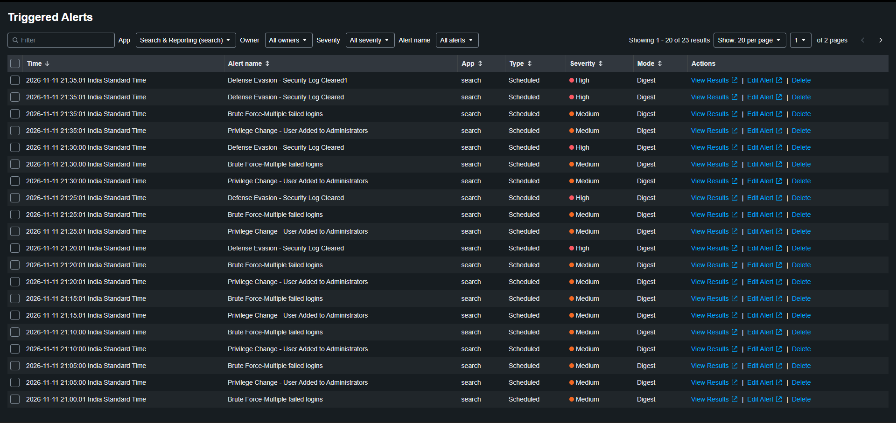

# Splunk Windows Detection Lab

## Project Overview
This repository contains a series of custom Splunk detection rules designed to identify common adversary techniques mapped to the MITRE ATT&CK framework. The detections were built, tested, and tuned in a live Windows lab environment utilizing Sysmon, Windows Security, and Windows System event logs.

## Lab Environment
* **Target Host:** Windows 10/11 (`LAPTOP-KLRQ0OUG`)
* **SIEM:** Splunk Enterprise
* **Index:** `win_lab`
* **Telemetry Sources:** `WinEventLog:Security`, `WinEventLog:System`, `Sysmon`

## Detection Rules
Each detection includes the SPL query, trigger conditions, false positive analysis, and Level 1 triage steps. 

1. **[Detection 01: Credential Access - Brute Force](detections/01-brute-force.md)**
   * **MITRE ATT&CK:** T1110.001 (Password Guessing)
   * **Log Source:** Security `EventCode=4625`
2. **[Detection 02: Privilege Escalation - User Added to Local Admins](detections/02-new-admin-user.md)**
   * **MITRE ATT&CK:** T1098 (Account Manipulation)
   * **Log Source:** Security `EventCode=4732`
3. **[Detection 03: Defense Evasion - Security Log Cleared](detections/03-log-cleared.md)**
   * **MITRE ATT&CK:** T1070.001 (Clear Windows Event Logs)
   * **Log Source:** Security `EventCode=1102`
4. **[Detection 04: Persistence - New Windows Service Installed](detections/04-new-service-installed.md)**
   * **MITRE ATT&CK:** T1543.003 (Windows Service)
   * **Log Source:** System `EventCode=7045`
5. [Detection 05: Suspicious Payload Delivery (LOLBin)](detections/05-sysmon-file-creation.md)
   * **MITRE ATT&CK:** T1105 (Ingress Tool Transfer)
   * **Log Source:** Sysmon `EventCode=11`

## Alert Tuning & Noise Reduction
During the initial deployment of the scheduled alerts, overlapping search windows resulted in duplicate alert triggers for single events.

**Resolution:**
To eliminate duplicate triggers and reduce alert fatigue, the scheduled searches were tuned to strictly align the cron schedule with the lookback window. All alerts were standardized to run every 5 minutes (`*/5 * * * *`) with a precise 5-minute relative lookback (`-5m` to `now`). Trigger conditions were set to evaluate **Number of Results > 0** firing exactly once per schedule window.
