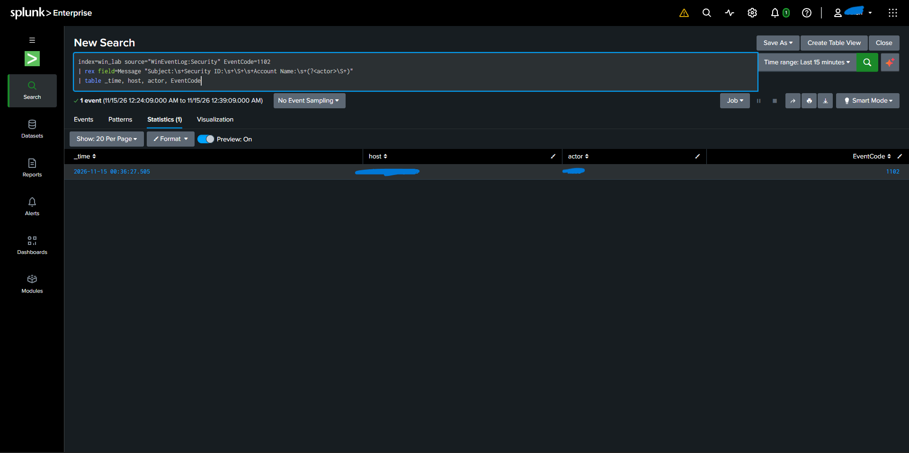
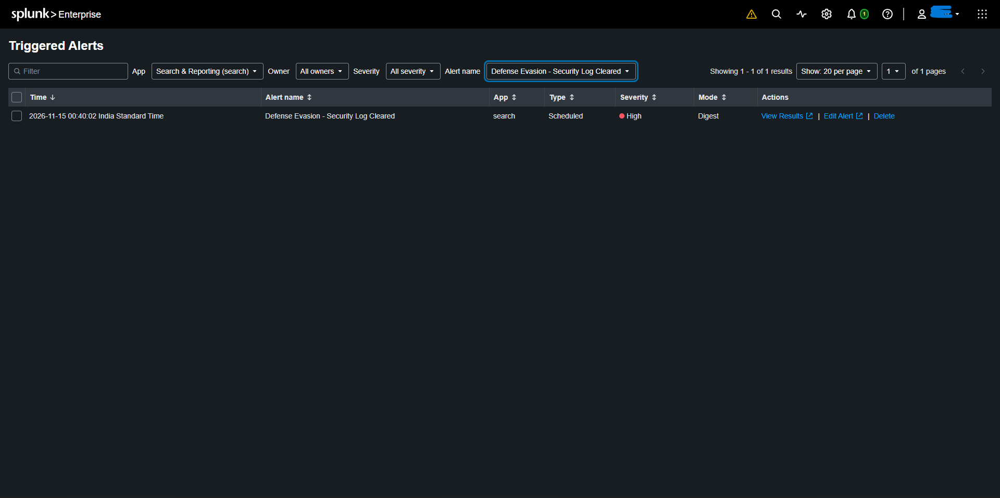

# Detection 03: Security Log Cleared

MITRE ATT&CK: T1070.001 (Indicator Removal: Clear Windows Event Logs)
Severity: High
Log source: Windows Security log, EventCode 1102

## What it detects
Someone cleared the Windows Security event log. Attackers do this to hide evidence of their activity.

## SPL
```spl
index=win_lab source="WinEventLog:Security" EventCode=1102
| rex field=Message "Subject:\s+Security ID:\s+\S+\s+Account Name:\s+(?<actor>\S+)"
| table _time, host, actor, EventCode
```

## Alert settings
Scheduled every 5 minutes, searching the last 5 minutes. Triggers when results > 0.

## Possible false positives
- An administrator clearing logs deliberately
- A maintenance or cleanup script

## L1 triage steps
1. Identify which account cleared the log and on which host
2. Check what happened just before (suspicious logins, new accounts, new services)
3. Confirm whether this was a planned change
4. Check whether logs were already forwarded off the machine

## Escalation
Log clearing outside an approved change window goes to L2.

## Evidence


