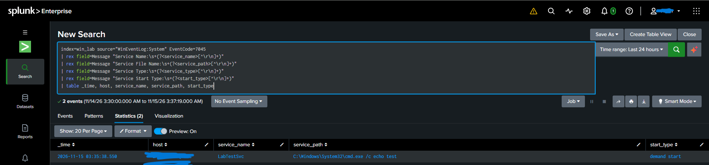
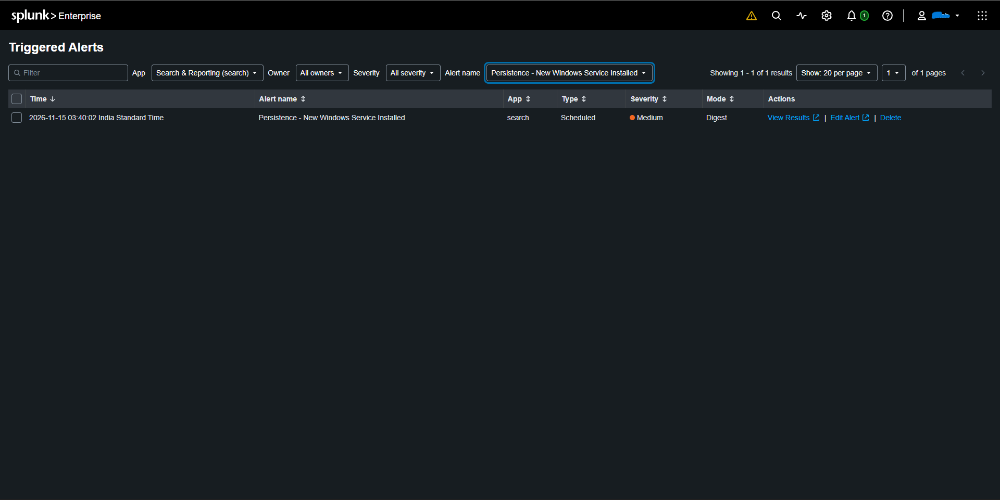

# Detection 04: New Windows Service Installed

MITRE ATT&CK: T1543.003 (Create or Modify System Process: Windows Service)
Severity: Medium
Log source: Windows System log, EventCode 7045

## What it detects
A new service was installed on a Windows host. Attackers and lateral movement tools (such as PsExec, Impacket, and Cobalt Strike) frequently register malicious services to execute payloads as `SYSTEM` or maintain persistence across reboots.

## SPL
```spl
index=win_lab source="WinEventLog:System" EventCode=7045
| rex field=Message "Service Name:\s+(?<service_name>[^\r\n]+)"
| rex field=Message "Service File Name:\s+(?<service_path>[^\r\n]+)"
| rex field=Message "Service Type:\s+(?<service_type>[^\r\n]+)"
| rex field=Message "Service Start Type:\s+(?<start_type>[^\r\n]+)"
| table _time, host, service_name, service_path, start_type
```

## Alert settings
Scheduled every 5 minutes, searching the last 5 minutes. Triggers when results > 0.

## Tuning notes
- **Legitimate software updates:** Routine updates for browsers, drivers, or endpoint agents occasionally register temporary services. In production, known vendor service paths under `C:\Program Files\` can be baselined while prioritizing services executing from `Users`, `Temp`, `AppData`, or inline `cmd.exe`/`powershell.exe` commands.

## Possible false positives
- Legitimate software installations or Windows feature updates
- IT administration or endpoint management agents deploying packages

## L1 triage steps
1. Inspect `service_path` to see what binary or command the service executes and where it resides on disk.
2. Check if `service_path` invokes `cmd.exe`, `powershell.exe`, `rundll32.exe`, or points to a user-writable directory (`Temp`, `AppData`, `Users`, `Public`).
3. Correlate with Security logs (`EventCode=4624` / `4672`) around `_time` to identify which user account authenticated and registered the service.
4. Check the binary hash and digital signature of the executable on `host`.

## Escalation
Any service pointing to an unsigned binary, script interpreter, or non-standard directory outside an approved software deployment escalates immediately to L2.

## Evidence


