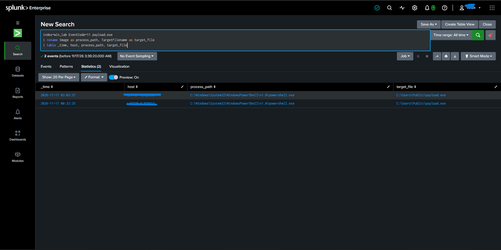
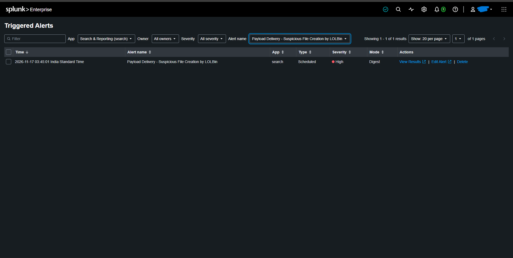

# Detection 05: Suspicious File Creation by LOLBin

MITRE ATT&CK: T1105 (Ingress Tool Transfer)
Severity: High
Log source: Sysmon Operational, EventCode 11 (File Create)

## What it detects
A native Windows binary ("Living off the Land" / LOLBin) such as `powershell.exe` writing a new executable file to a public or user-writable directory. Attackers frequently use built-in tools to download and drop malicious payloads directly to disk to bypass perimeter defenses and application control whitelisting.

## SPL
```spl
index=win_lab EventCode=11 payload.exe
| rename Image as process_path, TargetFilename as target_file
| table _time, host, process_path, target_file
```
## Alert settings
Scheduled every 5 minutes, searching the last 5 minutes. Triggers when Number of Results > 0. Action: Add to Triggered Alerts (Severity: High).

## L1 triage steps
1. Inspect the `target_file` extension. Is it an executable (.exe, .dll) or a script (.ps1, .bat, .vbs)?
2. Identify the `process_path` of the LOLBin that dropped the file. If it is `powershell.exe`, `cmd.exe`, or `certutil.exe` dropping an unknown payload, the activity is highly suspicious.
3. Pivot to Sysmon `EventCode=1` (Process Creation) using the `_time` of the event to locate the exact command-line string executed by the LOLBin to initiate the download.
4. Check if the dropped payload was subsequently executed by looking for new `EventCode=1` logs originating from the `target_file` path.
5. Extract the file hash from Sysmon `EventCode=11` or `EventCode=15` (FileStream) and check its reputation on VirusTotal.

## Escalation
Any unrecognized executable or script dropped by a built-in Windows utility into a public or temporary directory should be immediately escalated to L2 for malware analysis, endpoint isolation, and credential revocation.

## Evidence



